# MarketPlace Analytics — Maelys

MVP de plateforme data pour **Maelys Marketplace** : ingestion automatique des
commandes de la base du site (MySQL) via l'API du backoffice, Data Warehouse dimensionnel (Kimball),
KPIs dans Metabase, détection d'anomalies et supervision Prometheus / Grafana.

| | |
|---|---|
| **Source (OLTP)** | MySQL 8.4 — base du site (vendeurs, produits, clients, commandes), exposée par l'API Flask |
| **Orchestration** | Airflow 3.1.8 (CeleryExecutor) — 4 DAGs |
| **Raw layer** | MinIO (S3) — `s3://data-lake/raw/<entité>/dt=YYYY-MM-DD/data.json` |
| **Data Warehouse** | PostgreSQL 18 — schémas `staging` / `dwh` / `analytics` |
| **BI** | Metabase 0.59.6.1 — 5 dashboards, 21 questions SQL |
| **Observabilité** | StatsD → Prometheus → Grafana (3 dashboards + 1 alerte) |
| **Tests** | pytest — 21 tests (DAGs, Hook mocké, DQ avec DB mockée, idempotence réelle) |

**État livré** : 472 432 commandes sur 58 jours chargées, idempotence prouvée,
21/21 tests verts, toutes les user stories US-01 → US-07 couvertes
(MVP + bonus *Should* + bonus *Could*).

---

## 1. Architecture

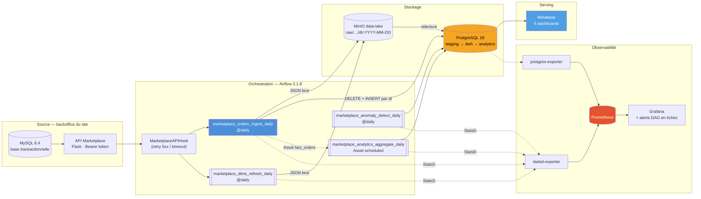

### Flux d'un run du pipeline principal

```mermaid
sequenceDiagram
  participant S as Scheduler
  participant H as MarketplaceAPIHook
  participant A as API Marketplace
  participant O as MySQL backoffice
  participant M as MinIO
  participant P as PostgreSQL DWH
  participant G as DAG analytics
  S->>H: extract_orders_to_raw (ds)
  H->>A: GET /orders?date=ds (Bearer, retry ×3)
  A->>O: SELECT … FROM orders WHERE order_date = ds
  O-->>A: lignes de la journée
  A-->>H: ~8 500 commandes (JSON)
  H->>M: PUT raw/orders/dt=ds/data.json
  S->>P: load_staging_orders : relit MinIO, DELETE + COPY staging.orders
  S->>P: data_quality_staging : not_empty / not_null / no_future_date
  alt DQ OK
    S->>P: transform_fact_orders : BEGIN; DELETE dt=ds; INSERT …; COMMIT
    P-->>G: événement Asset fact_orders
    G->>P: rebuild analytics.* (daily_summary, seller_daily, category_daily)
  else DQ KO
    S->>P: alert_dq_failure → analytics.dq_alerts, run marqué failed
  end
```

Le graphe réel dans Airflow :

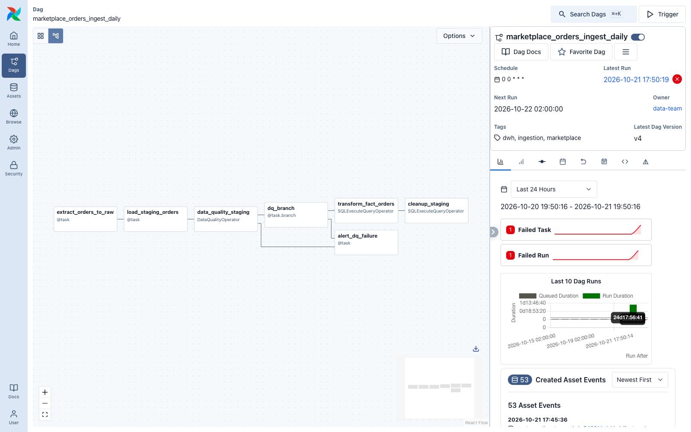

---

## 2. Démarrage

Prérequis : Docker Desktop (≥ 8 Go de RAM alloués), Python 3 sur l'hôte (avec `requests`) pour le script Metabase.

```bash
# Tout-en-un : stack + dimensions + 50 jours d'historique + dashboards Metabase (~10 min)
./scripts/bootstrap.sh
```

Ou pas à pas :

```bash
docker compose up -d --build          # ~2 min ; vérifier : docker compose ps (tout healthy)
curl http://localhost:5002/health     # API simulée

# Dimensions puis pipeline principal sur une date
docker compose exec airflow-worker airflow dags test marketplace_dims_refresh_daily 2026-04-07
docker compose exec airflow-worker airflow dags test marketplace_orders_ingest_daily 2026-04-07

./scripts/backfill.sh 2026-10-01 2026-10-07   # historique (US-06)
python3 metabase/setup_metabase.py             # compte admin + source DWH + 5 dashboards
docker compose exec airflow-worker pytest tests/ -v
```

### Accès

| Service | URL | Identifiants |
|---|---|---|
| Airflow | http://localhost:8080 | `airflow` / `airflow` |
| Metabase | http://localhost:3000 | `admin@maelys.local` / `Admin2026!` |
| Grafana | http://localhost:3001 | `admin` / `admin` |
| Prometheus | http://localhost:9090 | — |
| API Marketplace | http://localhost:5002 | Bearer `formation-token-2026` |
| PostgreSQL DWH | `psql -h localhost -p 5433 -U dwh_user -d dwh` | mot de passe dans `.env` |
| MySQL backoffice (base du site) | `docker compose exec mysql-backoffice mysql -ubackoffice_user -p --default-character-set=utf8mb4 backoffice` · ou un outil graphique sur `localhost:3306` · ou Metabase (« Backoffice Maelys ») | `backoffice_password_2026` |
| MinIO (API S3) | http://localhost:9000 | `minio_admin` / `minio_password_2026` |

### Écarts volontaires avec le cahier des charges

| Point | Raison | Solution retenue |
|---|---|---|
| API exposée sur **5002** (pas 5000 ni 5001) | Le port 5000 est occupé par AirPlay sur macOS, le 5001 par le backend Addlean | Mapping `5002:5000` ; en interne, `api-marketplace:5000` |
| `postgres-airflow` non exposé | Un PostgreSQL local occupe déjà 5432 sur l'hôte | Accessible depuis les conteneurs uniquement |
| Image MinIO **Bitnami** | `minio/minio` n'est plus publiée sur Docker Hub / quay.io | `bitnamilegacy/minio` + `bitnamilegacy/minio-client` pour `minio-init` |
| Pas de console MinIO (9001) | Retirée des builds communautaires de MinIO en 2025 | Bucket créé par `minio-init` ; exploration via `mc` |
| Métadonnées Metabase dans **PostgreSQL** | La base H2 s'est corrompue lors d'un arrêt brutal de Docker | Option « production-grade » du §10.1 : base `metabase` sur `postgres-airflow` |
| Dashboard Grafana **24832** au lieu de 11010 | L'ID 11010 correspond aujourd'hui à « Kube Carbon » sur grafana.com | 24832 « Airflow 3 » (compatible métriques StatsD par défaut) + 9628 PostgreSQL + un dashboard maison |

---

## 3. La source : base MySQL du site + API Marketplace

Le kit ne fournissant pas l'API, la source a été construite dans [`api/`](api/) comme dans une
vraie entreprise : **une base transactionnelle (OLTP) et une API devant elle**.

| Brique | Rôle |
|---|---|
| **MySQL 8.4 `mysql-backoffice`** ([`init-backoffice/schema.sql`](init-backoffice/schema.sql)) | La base du site : `sellers`, `products`, `customers`, `orders` (clés étrangères), `recorded_days` |
| **`backoffice-seed`** ([`api/seed.py`](api/seed.py)) | Remplit la base au démarrage (rejouable) : 2 400 vendeurs, 180 000 produits, 1 200 000 clients, 60 derniers jours de ventes |
| **API Flask `api-marketplace`** ([`api/app.py`](api/app.py)) | La seule porte d'accès pour l'équipe data : lit la base MySQL, vérifie le token, renvoie du JSON |

L'équipe data n'accède jamais directement à la base du site (sécurité, pas de charge sur la
production, contrat stable) : Airflow passe par l'API, comme l'exige le cahier.
Une journée jamais demandée est d'abord enregistrée dans MySQL par le simulateur du site
([`api/db.py`](api/db.py), `record_day`), puis toujours relue depuis MySQL.

Contrat de l'API : `GET /health`, `/orders?date=`, `/sellers?limit=`, `/products`,
`/customers?limit=` ; auth Bearer (401 sinon) ; **seed = md5(date)** → une même date donne
toujours les mêmes commandes.

Volumétrie calibrée sur le cahier des charges : 2 400 vendeurs, 180 000 produits,
~8 500 commandes/jour, ~4,2 M€ de CA mensuel (panier moyen ~16,5 €). Le générateur
injecte volontairement :

- des **chutes de ventes** (~6 % des jours à 45-65 % du volume) → anomalie `revenue_drop` ;
- des **prix suspects** (≈ 0,07 % des commandes : prix ×100 ou 0,01 €) → anomalie `suspicious_price` ;
- des **erreurs 503 aléatoires** (`API_FAILURE_RATE=0.05`) → éprouve le retry du Hook ;
- des vendeurs peu actifs ou ayant arrêté → table « vendeurs inactifs ».

---

## 4. Modèle de données (Kimball)

DDL complet : [`init-db/schema.sql`](init-db/schema.sql) (exécuté au premier démarrage de `postgres-dwh`).

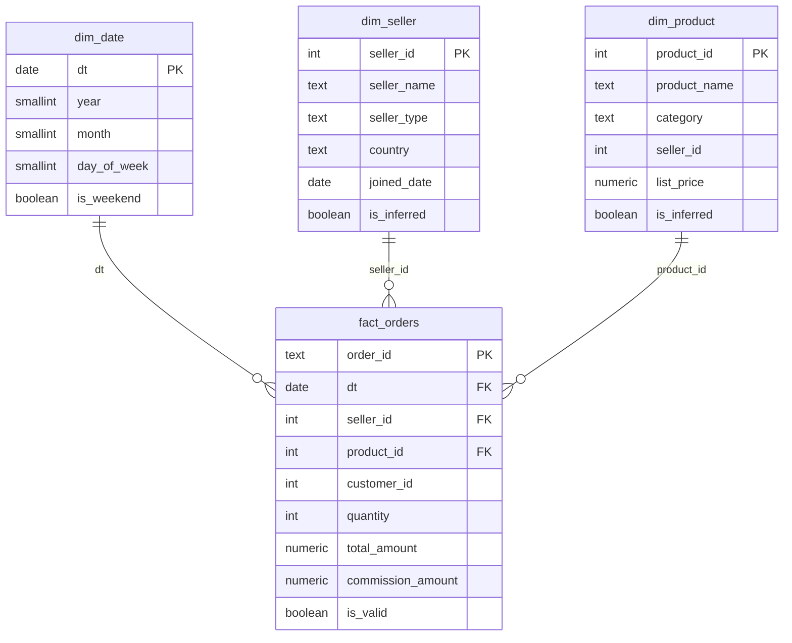

| Schéma | Tables | Rôle |
|---|---|---|
| `staging` | `orders` (partition logique `dt`), `sellers`, `products` | Données brutes typées, rechargées de façon idempotente |
| `dwh` | `dim_date`, `dim_seller`, `dim_product`, `fact_orders` | Étoile : grain = 1 commande ; PK sur les dimensions, FK depuis le fait |
| `analytics` | `daily_summary`, `seller_daily`, `category_daily`, `anomalies`, `dq_alerts` | Agrégats pré-calculés pour Metabase + journal des anomalies |

Choix de modélisation :

- **CA = commandes valides** (`is_valid` = ni annulée ni remboursée) ; **commission = 12 %** du CA,
  paramétrable via `params.commission_rate`.
- **Membres inférés** (« late arriving dimensions ») : un vendeur/produit vu dans une commande
  avant le refresh des dimensions est créé avec `is_inferred = TRUE` pour respecter les FK,
  puis écrasé par `marketplace_dims_refresh_daily`. Le pipeline ne casse jamais à cause de l'ordre des DAGs.
- `dim_date` pré-remplie 2024 → 2027 et complétée à la volée.
- Pas de SCD2 (hors périmètre, §7.4).

---

## 5. DAGs

| DAG | Schedule | Rôle |
|---|---|---|
| `marketplace_dims_refresh_daily` | `@daily` | API → MinIO → `staging.sellers/products` → upsert `dim_seller` / `dim_product` |
| `marketplace_orders_ingest_daily` | `@daily` | **Pipeline principal** : extract → raw → staging → DQ → branch → `fact_orders` |
| `marketplace_analytics_aggregate_daily` | **Asset** `fact_orders` | Reconstruit les 3 tables `analytics` à chaque mise à jour du fait |
| `marketplace_anomaly_detect_daily` | `@daily` | Attend l'ingestion (`ExternalTaskSensor`), détecte chutes de CA et prix suspects |

Tous les DAGs : `catchup=False`, `retries=2`, tags, docs. `@daily` est configuré avec
`create_cron_data_intervals=true` : le run de minuit traite la journée écoulée (`ds` = J-1).

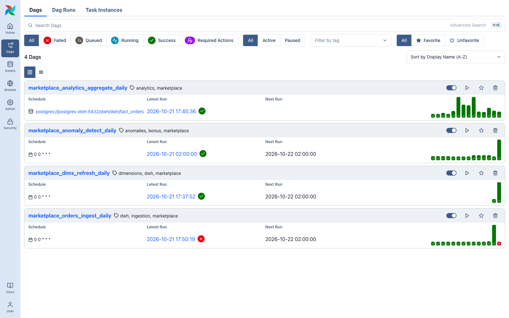

### Custom Hook — `MarketplaceAPIHook`

[`plugins/marketplace/hooks.py`](plugins/marketplace/hooks.py) — hérite de `BaseHook`, lit la
Connection `marketplace_api` (`host` = URL, `password` = token Bearer : **aucun secret dans le
code**, la Connection est injectée via `AIRFLOW_CONN_MARKETPLACE_API` depuis le `.env`).
Méthodes : `get_orders(date)`, `get_sellers(limit)`, `get_products()`, `get_customers(limit)`, `health()`.
Retry exponentiel sur timeout, erreur réseau, 429 et 5xx ; pas de retry sur 4xx (un 401 est une
erreur de configuration). Testé unitairement avec `requests` mocké.

### Custom Operator — `DataQualityOperator` (bonus)

[`plugins/marketplace/operators.py`](plugins/marketplace/operators.py) — 3 règles configurables :
`not_empty`, `not_null` (liste de colonnes), `no_future_date`. Renvoie `{"passed", "results"}` en
XCom ; le `@task.branch` aval choisit `transform_fact_orders` (OK) ou `alert_dq_failure` (KO :
écrit dans `analytics.dq_alerts` et fait échouer le run pour déclencher l'alerte Grafana).
Identifiants SQL validés par regex (pas d'injection).

Démonstration : `airflow dags test marketplace_orders_ingest_daily 2026-12-24` (date future) →
`no_future_date ❌ 10 673 violations` → branche d'alerte, **0 ligne** chargée dans `fact_orders`.

---

## 6. Idempotence (obligatoire)

[`dags/sql/transform_fact_orders.sql`](dags/sql/transform_fact_orders.sql) :

```sql
BEGIN;
  -- membres inférés (dim_date / dim_seller / dim_product) … ON CONFLICT DO NOTHING
  DELETE FROM dwh.fact_orders WHERE dt = '{{ ds }}';
  INSERT INTO dwh.fact_orders (...) SELECT ... FROM staging.orders WHERE dt = '{{ ds }}';
COMMIT;
```

Toutes les étapes sont rejouables : le raw MinIO est écrasé (`replace=True`), le staging est
rechargé par `DELETE … WHERE dt` + `COPY` dans une seule transaction, le fait par
`DELETE + INSERT`, les dimensions par `INSERT … ON CONFLICT DO UPDATE`, les agrégats par
`TRUNCATE + INSERT` transactionnel, les anomalies par `DELETE + INSERT` par `dt`.

**Preuve** (test du formateur, §12.3) — `./scripts/test_idempotence.sh 2026-04-07` :

```
▶ Run 1 : airflow dags test marketplace_orders_ingest_daily 2026-04-07
  → dwh.fact_orders WHERE dt='2026-04-07' : 7350 lignes
▶ Run 2 : airflow dags test marketplace_orders_ingest_daily 2026-04-07
  → dwh.fact_orders WHERE dt='2026-04-07' : 7350 lignes
✅ Idempotent : 7350 = 7350
```

Rejoué 5 fois au total sur cette date : toujours 7 350 lignes, 7 350 `order_id` distincts et le même
CA au centime (130 182,15 €). Le test pytest `test_transform_is_idempotent` exécute en plus le vrai
SQL 3 fois contre la base.

---

## 7. Backfill (US-06, bonus)

```bash
./scripts/backfill.sh 2026-08-25 2026-08-31
```

Le script utilise `airflow backfill create` (Airflow 3) pour `marketplace_orders_ingest_daily`,
attend la fin des runs, puis rejoue `marketplace_anomaly_detect_daily` sur la même plage ;
le DAG `analytics` se redéclenche seul via l'Asset. Exécution réelle : 7 jours chargés en ~1 min.

```
 2026-08-25 |      6953 | 119080.75
 2026-08-26 |      6853 | 121579.40
 …
 2026-08-31 |      6664 | 120667.38
```

Historique chargé au total : 2026-04-07 + du 2026-08-25 au 2026-10-20 (58 jours, 472 432 commandes).

---

## 8. Dashboards Metabase

Créés **par code** ([`metabase/setup_metabase.py`](metabase/setup_metabase.py), API REST
Metabase) : rejouables, versionnés, et recréables en 30 s si l'instance est perdue.
Connexion DWH : host `postgres-dwh`, port interne `5432`.

| Dashboard | User story | Contenu |
|---|---|---|
| 1 · Executive Summary (MVP) | US-01, US-02 | CA / commandes / panier moyen / vendeurs actifs du jour (vs veille), CA 30 jours, Top 5 vendeurs du jour |
| 2 · Top Sellers (MVP) | US-02 | Top 10 vendeurs du mois, évolution du CA des top 3 sur 30 jours, vendeurs inactifs > 7 jours |
| 3 · Commissions (bonus) | US-03 | Commission du jour, du mois, par jour, récapitulatif quotidien pour la facturation |
| 4 · Catégories (bonus) | US-04 | Répartition du CA, performance par catégorie, CA hebdomadaire empilé |
| 5 · Anomalies & Qualité (bonus) | US-05 | CA vs moyenne mobile 7 j et seuil 70 %, chutes détectées, prix suspects, alertes DQ |

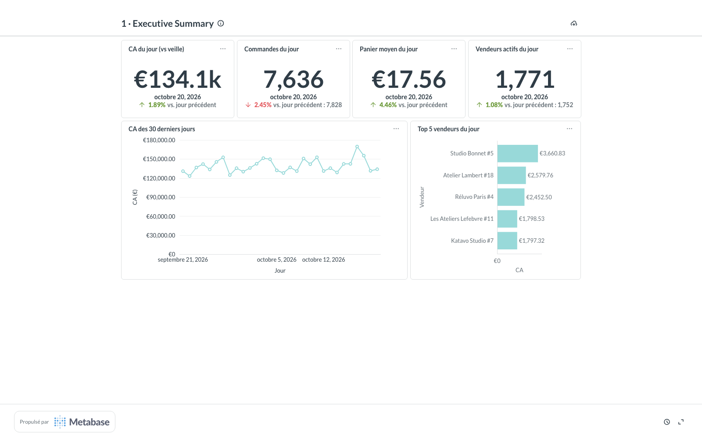
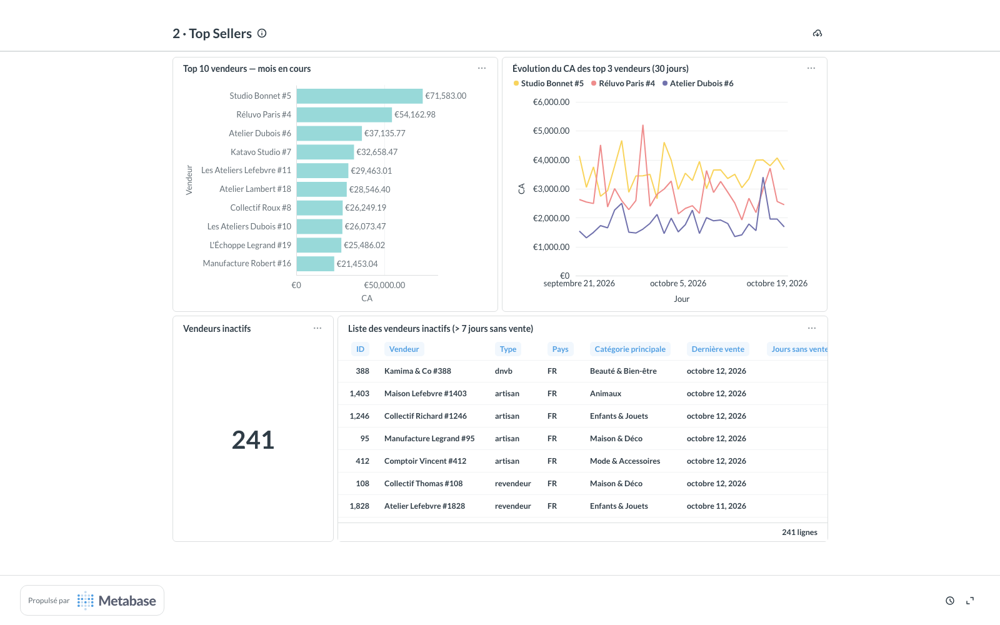
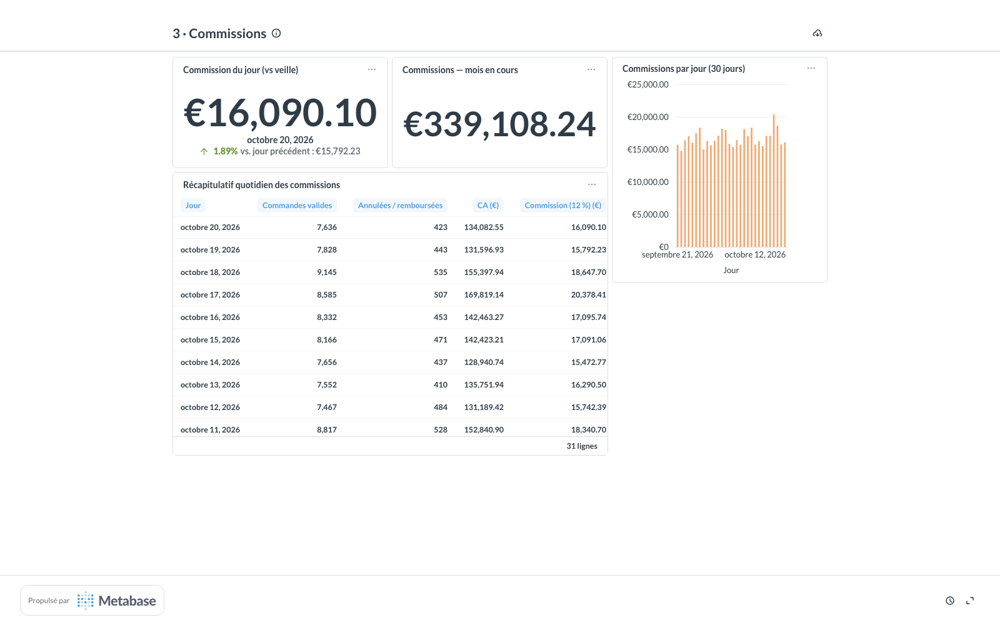
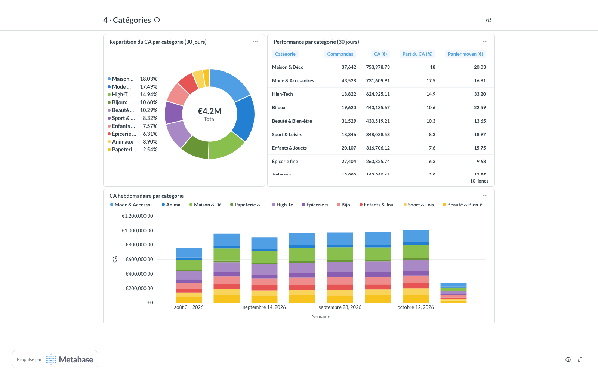
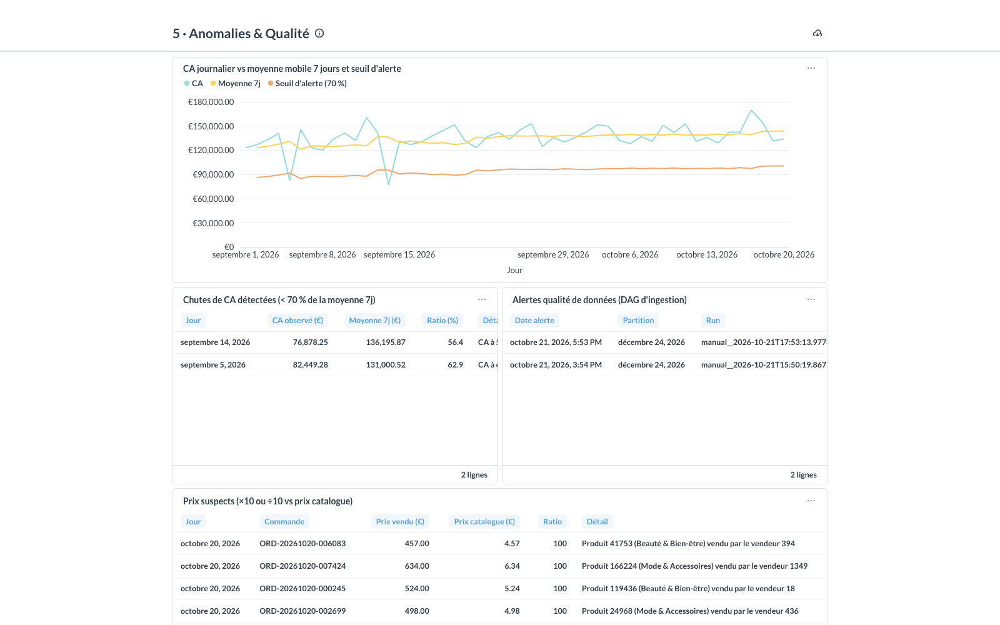

---

## 9. Détection d'anomalies (US-05, bonus)

`marketplace_anomaly_detect_daily` attend la fin de `transform_fact_orders` pour la même date
(`ExternalTaskSensor` en mode `reschedule`), puis :

- **revenue_drop** : CA du jour < 70 % de la moyenne des 7 jours précédents (seuil en `params`) ;
- **suspicious_price** : prix de vente ≥ 10× ou ≤ 1/10 du prix catalogue (`dim_product.list_price`).

Résultats sur l'historique : **2 chutes de CA** détectées (05/09 à 63 %, 14/09 à 56 %) et
**315 prix suspects**, conformes aux anomalies injectées par l'API.

---

## 10. Observabilité (bonus)

Airflow émet ses métriques en StatsD → `statsd-exporter` (mapping
[`observability/statsd_mapping.yml`](observability/statsd_mapping.yml) : `dag_id` / `task_id` /
`state` en labels) → Prometheus ; `postgres-exporter` expose le DWH. Grafana est entièrement
provisionné (datasource, dashboards, règle d'alerte) :

- **MarketPlace — Supervision du pipeline** (maison) : runs réussis / en échec, tâches par état,
  durée moyenne par tâche, taille du DWH, connexions ;
- **Airflow 3** (grafana.com 24832) et **PostgreSQL Database** (9628) ;
- **Alerte « DAG MarketPlace en échec »** (US-07) : se déclenche dès qu'un run échoue. L'expression
  `(x unless x offset 1h) or increase(x[1h])` compte aussi le premier échec d'une série toute
  neuve, que `increase()` seul ignore.

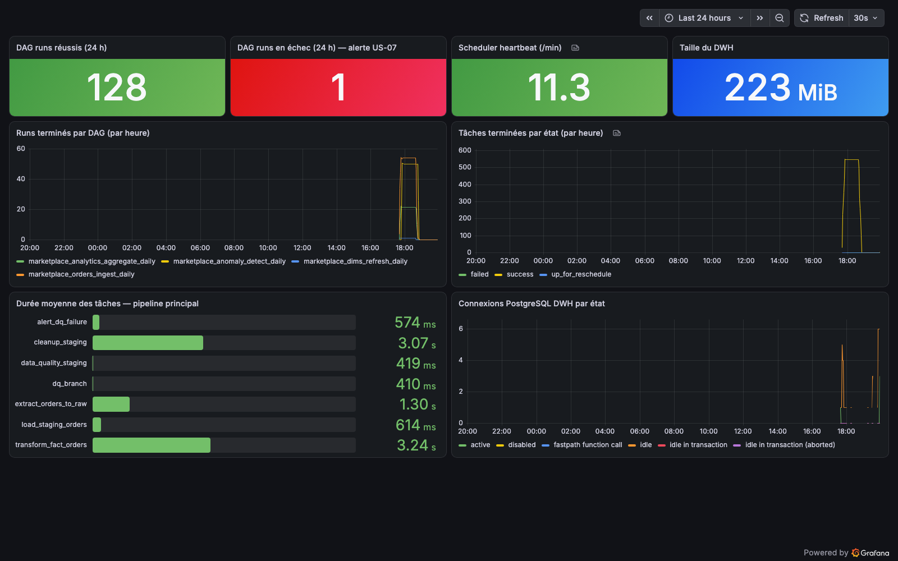
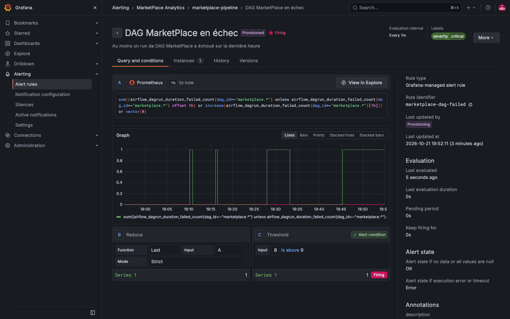

---

## 11. Tests

```bash
docker compose exec airflow-worker pytest tests/ -v      # 21 passed
```

| Fichier | Tests |
|---|---|
| `test_dags.py` | `test_no_import_errors`, `test_all_dags_catchup_false`, `test_marketplace_ingest_has_idempotent_transform`, présence des 4 DAGs, retries + tags, chaînage des tâches, scheduling par Asset, aucun token en dur |
| `test_hook.py` | Token lu depuis la Connection, paramètres d'appel, retry 503 → succès, timeout → échec après 4 tentatives, pas de retry sur 401, Connection sans token rejetée (**`requests` mocké**) |
| `test_data_quality.py` | Règles OK / partition vide / NULL + dates futures, `fail_on_error`, règle inconnue, injection SQL (**base mockée**) |
| `test_idempotence_integration.py` | Exécute 3 fois le vrai SQL de transformation contre le DWH et compare les résultats |

---

## 12. Definition of Done

- [x] `marketplace_orders_ingest_daily` tourne en success (scheduled, manuel, backfill)
- [x] `dwh.fact_orders` contient des données (58 dates, 472 432 lignes)
- [x] Rejouer le même run 2 fois = même `COUNT(*)` (7 350 = 7 350)
- [x] Metabase affiche ≥ 2 dashboards avec données réelles (5 livrés)
- [x] ≥ 3 tests pytest passent (21)
- [x] README avec schéma Mermaid et instructions de lancement

---

## 13. Choix techniques

- **Raw layer d'abord** : l'extraction écrit le JSON brut dans MinIO puis la tâche suivante le
  **relit** depuis MinIO. Ainsi le staging peut être reconstruit sans rappeler l'API, et aucun gros
  volume ne transite par XCom (seule la clé S3 est passée).
- **`COPY` plutôt qu'`INSERT` ligne à ligne** pour le staging : ~8 500 lignes en < 1 s.
- **SQL dans des fichiers** (`dags/sql/`) rendus par Jinja (`{{ ds }}`, `{{ params.* }}`) via
  `SQLExecuteQueryOperator` : lisible, testable, pas de date en dur.
- **Asset scheduling** : l'agrégation ne tourne que quand le fait a réellement changé, y compris
  pendant un backfill.
- **Agrégats en full rebuild transactionnel** : idempotent par construction et < 2 s à ce volume ;
  à plus grande échelle on passerait à un rebuild par partition `dt`.
- **Dashboards as code** : Metabase est configuré par script, donc reproductible.
- **Rétention du staging** : `cleanup_staging` supprime les partitions de plus de 35 jours (le raw
  MinIO reste la source de rejeu).

### Ce qu'on ferait avec plus de temps

dbt pour les transformations SQL (tests de schéma, documentation, lineage) ; partitionnement
natif PostgreSQL de `fact_orders` par mois ; notifications Slack/e-mail branchées sur l'alerte
Grafana ; Great Expectations à la place du `DataQualityOperator` ; CI exécutant pytest.

---

## 14. Structure du dépôt

```
├── docker-compose.yaml        # 19 services (MySQL, API, Airflow, PostgreSQL ×2, MinIO, Metabase, observabilité)
├── Dockerfile                 # image Airflow 3.1.8 + pytest
├── .env.example               # variables (copier en .env)
├── api/                       # API Flask + simulateur du site (déterministe : seed = md5(date))
├── init-backoffice/           # DDL de la base MySQL du site (OLTP)
├── dags/                      # 4 DAGs + sql/ (transformations Jinja)
├── plugins/marketplace/       # MarketplaceAPIHook, DataQualityOperator, helpers
├── init-db/schema.sql         # DDL staging / dwh / analytics
├── init-airflow-db/           # base applicative de Metabase
├── metabase/setup_metabase.py # dashboards as code
├── observability/             # Prometheus, mapping StatsD, provisioning Grafana
├── scripts/                   # bootstrap, backfill, test d'idempotence
├── tests/                     # 21 tests pytest
└── docs/screenshots/          # captures Airflow, Metabase, Grafana, MinIO
```
